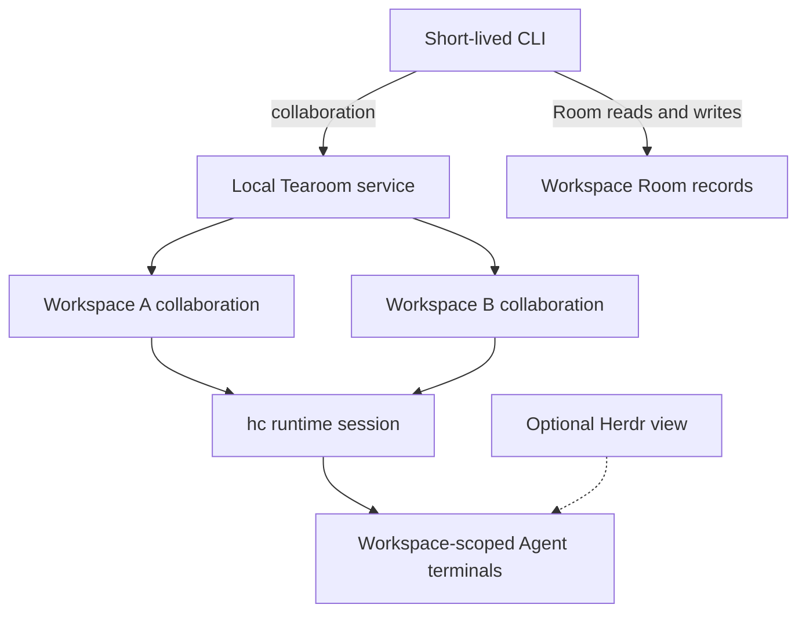
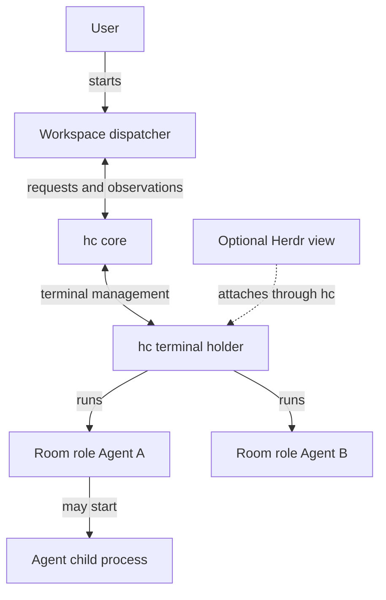

# Room collaboration delivery

This is the local integration for the product and
[user journeys](../domain/user-stories.md). One unattended builder–reviewer
workflow has been exercised; wider acceptance remains open.
The [implementation status](status.md) records what ships. The kernel owns
Room history; this integration owns configuration, delivery and recovery.
The [product boundary](../product.md#conversation-and-runtime-policy) leaves
Agent context management and work decisions to the Agent and its tool.

## Roles and Room panels

Define a reusable role with a stable name, description, agent command,
working-directory setting, and role instructions. Role instructions are an
initial message, not a guaranteed system prompt. Credentials
remain with the agent environment; Room messages and role descriptions do not
store secrets.

Room creation may select role definitions; they can also be changed later. The roster is discoverable
through the CLI and is routing configuration, not permission to read or write.
One Room-role binding identifies one logical panel and at most one active hc
terminal at a time. Different Rooms using the same definition have separate
terminals and conversations. A panel may be created on demand; replacing a
terminal does not itself replace or resume the Agent conversation. A CLI view should
show the role name, description, agent type and observed availability, including
unknown or blocked; it must not claim that an absent or unready panel is ready.
Configuration and commands are documented in the
[Agent integration guide](../reference/agent-integration.md).

### Conversation continuity and replacement

The [product policy](../product.md#conversation-and-runtime-policy) requires
one continuing Agent conversation for each Room-role instance. On its first
wake, start a conversation; later addressed messages go to that conversation,
queued while it is busy. A persistent panel alone is insufficient if the
program inside it starts a fresh conversation on each turn. Role definitions
remain reusable across Rooms, but their conversation histories are separate.
The current implementation starts a new conversation with each new panel;
Tearoom does not bind or resume an Agent session identity.

The product requires recovery of the existing conversation when supported,
and visible reconciliation when its state is uncertain. The current adapter
cannot resume an identified Agent conversation. If a previously used panel is
missing, delivery becomes uncertain instead of silently starting a new one.
An intentional fresh conversation is
an explicit replacement of the Room-role instance, with the prior outcome and
any pending delivery reconciled first. Room records remain the durable shared
history for rebuilding context; conversation and panel identifiers are runtime
integration state, not new product entities or Record fields.

`tearoom collab restart --room <room> --role <role>` is that explicit
replacement: it stops the live panel and starts the configured command again.
It refuses while the panel is working and refuses, without `--confirm`, while
a submitted or uncertain delivery still awaits reconciliation. A replacement
is a new conversation: Tearoom stores no conversation identifier and does not
resume one on the Agent's behalf, because the Agents name continuation
differently and a "most recent" choice can reach another role's conversation.
A restarted Agent can consult Room records; its context remains its own
responsibility. A newly started Agent may report `idle` before its own setup is
finished; the resulting delivery is uncertain and must be inspected rather
than assumed delivered. See
[implementation status](status.md#open-work).

## Message and addressing

All messages remain visible in the Room's single append-only stream. The CLI
stores target role names in structured message content; the Record contract
does not gain recipient fields. The [CLI reference](../reference/cli.md)
defines how explicit targets are selected and
validated. If an unknown role is found in a persisted record, the runtime
reports an undeliverable target without changing the record or routing to
another role.

The wake carries Room records since the role's last confirmed delivery through
the addressed record; the first wake and an explicit restart carry the Room
history through that record. The Agent may read more history if needed. The Room
stream remains the shared history. Builder and reviewer work in the same Room; the
reviewer is a different agent instance. A shared ancestor Room can carry
coordination across branches, with the relevant roles configured there.

## Delivery and recovery

A local integration process observes Room appends and uses hc to start a role
terminal or deliver a prompt to it. hc events report terminal facts, not Room
appends. hc events are hints: on startup and reconnect the integration
scans Room records from its durable boundary, because no event stream
provides replay. The integration stores its delivery progress
outside the Room stream and kernel, keyed by workspace, Room, record sequence,
and target role. It persists delivery intents before moving its scan boundary;
each intent then tracks its own outcome. Re-scanning must not create a second
delivery for that key.
Room-role dispatch is serialized, with later messages pending while that role
is busy. A workspace lock admits one local dispatcher for its lifetime. A
separate delivery-state lock serializes each scan with manual operations; when
it is briefly busy, the dispatcher skips that scan and tries again on the next
iteration. Other lock errors remain failures. Manual operations may still
report a busy delivery-state lock and can be retried.

## Target: local collaboration service

The desired lifecycle is one background Tearoom service per local user, serving
multiple workspaces. The CLI makes a request and exits; closing the CLI or an
optional view does not stop collaboration. The service replaces manually
running a long-lived `collab run` in each workspace. This is a target design,
not a shipped command or a claim that the service exists today. The current
implementation and its limits are below.

The service owns Room routing and delivery policy. hc owns terminal execution;
Herdr remains an optional separate view. The arrows express responsibility and
access, not verified process ancestry or a claim that hc runs in the service
process. Workspaces, Rooms, Records, and Roles
retain their existing meanings. Service bookkeeping is not a new product
entity, a Room store, or an authorization boundary. The service is local to
the user and does not expose a remote hosting interface or grant access beyond
the operating-system permissions of that user.

### Lifecycle contract

- Collaboration starts the local service on demand. Starting it concurrently
  must yield one active service for the user, not competing dispatchers for a
  workspace. Read-only Room access must not require a running service. The
  user must be able to inspect whether the service is running, which workspaces
  it manages, and any unresolved recovery or cleanup failures.
- A workspace becomes known when collaboration is activated there. The
  service must retain enough local bookkeeping to find active workspaces after
  a restart; Room records and delivery state remain in their workspace. A
  missing, moved, or inaccessible workspace must be reported, not recreated or
  silently treated as another workspace. The service must not discover
  workspaces by scanning unrelated directories. It must retain ownership of a
  running terminal even if its Room or role binding is removed, until that
  terminal is stopped or its ownership is explicitly resolved.
- Closing a CLI or Herdr view leaves the service and Agent terminals running.
  An explicit service stop ends its managed Agent terminals across its active
  workspaces, preserves Room history, and reports incomplete cleanup. It must
  not stop independent hc terminals or another user's work. These are cutover
  requirements, not guarantees established by the current implementation.
- Stopping or losing the service can interrupt a delivery. The service must
  preserve or recover that uncertainty and require reconciliation when an
  action may already have happened; it must not silently replay such work or
  claim that a new Agent conversation resumed the old one.
- Explicit stop remains effective until a later collaboration operation starts
  the service again; merely reading Room history, logging in, or an automatic
  crash-restart mechanism must not override an explicit stop. The
  precise command names and which collaboration operation activates a
  workspace are implementation work, not current CLI promises.
- Service restart must reconcile registered workspaces and any identifiable
  terminals left by the prior run before dispatching more work. It must not
  assume a path identifies the same workspace after a move or replacement, or
  kill an unverified terminal. Pause dispatch for an unverified workspace
  until its identity is resolved. The identity and registration update rules
  are unresolved; a path hash alone is not a durable workspace identity.

### Process ownership and recovery limits

The service needs an explicit way to distinguish its terminals from other hc
users and to coordinate workspace activation, stop, and concurrent restart.
A Tearoom-owned hc session is the preferred isolation boundary; its startup,
ownership, and integration with existing hc sessions must be verified before
it can be used as the basis for whole-session cleanup. Stopping a shared hc
session wholesale is unsafe; if ownership cannot be established, the service
must report the problem rather than attempt broad cleanup. Ownership evidence
must survive removing Room or role configuration; its exact storage and
recovery design remain open. A possible design is to run the service as an hc-owned
parent terminal and attach its Agent terminals to it, allowing hc to notice a
service process exit; the current integration explicitly opts out of that
parent relation. This mechanism and its behavior across hc restart, startup
races, upgrades, and both supported operating systems require implementation
and tests before they become a guarantee.

Normal stop must attempt to end all managed terminals and report failures. A
service killed immediately cannot execute its own cleanup, and programs that
deliberately detach from their terminal may outlive it. Recovery after an
unexpected service or hc failure must identify remaining managed work without
killing unrelated processes or retrying uncertain deliveries. Whether and how
the service is restarted automatically after a crash, and how to contain
detached descendants on each platform, remain open until proven by boundary
tests; the design does not promise universal cleanup.

Before replacing the foreground dispatcher, exercise concurrent first starts;
multiple workspaces sharing one service; CLI exit while Agents continue;
explicit stop during a delivery; a simultaneous activation or restart; service
and hc interruption; recovery of an uncertain delivery; a missing or replaced
workspace; and independent hc terminals. Check both supported operating systems.
Prove which owned terminals and child processes actually stop, including a
detached-process probe, and report remaining cleanup failures. These are target
acceptance cases, not evidence that the service already passes them.

## Dispatcher lifecycle

The runtime has one dispatcher per active workspace and one hc core per hc
session. Workspaces using the same session share its core and terminal holder.
hc is compiled into the Tearoom executable, but its core and holder run as
separate long-lived processes. Herdr is an optional, separately installed
view; Room delivery does not require it.

The arrows show startup or management, not necessarily operating-system
parentage. The same hc session can contain other workspaces' terminals and
independently created terminals; stopping the whole hc core would affect them.

On Unix, when `collab run` returns or receives SIGINT/SIGTERM, it stops the
live Agent terminals owned by that workspace. It leaves the shared hc service
running so other workspaces keep their terminals. Submitted work interrupted
by this shutdown becomes uncertain and requires inspection before retrying.
This cleanup cannot run after SIGKILL, power loss, or a machine crash. Programs
that deliberately detach from their terminal can also outlive its stop; Tearoom
does not promise to find arbitrary detached processes. Shutdown is not serialized
with a concurrent manual panel restart, so a panel started during cleanup may
survive it. Inspect cleanup errors before assuming every terminal stopped.

For each directed message, resolve the configured role and its panel. A first
missing panel is started with its configured command and new Room records;
the integration checks hc's first-message result, since a created terminal does
not prove that task was sent. An existing ready panel receives new records
through hc. A busy panel leaves the message pending. Never force input into a
blocked or unready panel. hc readiness and reported status vary by agent; a tool
without reliable status cannot be assumed idle or done. When readiness cannot
be established, the delivery remains pending or is escalated.

hc 0.1.18 accepts an atomic `--if idle` guard but has no `--if done`. For a
panel reporting `done`, the current adapter rechecks its status and then sends
without `--force`; the check and send are not atomic. A concurrent actor could
start work in that gap. A blocked panel is still refused by hc. This remains
an open reliability limit, not an exactly-once or exclusive-use guarantee.

The runtime distinguishes pending, submission in progress, submitted, and
uncertain delivery. A successful terminal submission is not proof that the
agent completed the work. A finished Agent turn or a matching Room reply can
move a submitted delivery to completed, but a reply is an unverified claim: a signature and
reference do not authenticate the author. Replies cannot complete pending or
uncertain deliveries, so they cannot suppress work before submission or
resolve an ambiguous submission. The agent records its result or blocker in the
Room and references the triggering record; inspect that evidence when deciding
whether the claimed work is complete.
On interruption, refresh hc's terminal snapshot and inspect the Room before
deciding what to do. hc event sequence numbers restart and missed events yield
a snapshot, not a complete replay. A spawn or send timeout can mean the action
already happened: reconcile the panel and Room first. If delivery or an external
effect remains ambiguous, expose it for resolution instead of blindly starting
another agent or repeating the action. Exactly-once execution is not promised.

## First validation

Create a Room containing a builder and an independent reviewer backed by two
different agent tools. The builder writes progress and explicitly addresses the reviewer;
the reviewer reads that Room, records evidence and a verdict there, and asks
the builder to revise when needed. Verify roster discovery, per-Room panel
isolation, busy and unavailable targets, and no human relay. Include an agent
that does not report hc status and verify pending or escalation. Interrupt the
integration before and after submission and during a turn; show that pending
work is recovered or ambiguity is visible. Record actual runs in
[evaluations.md](../evaluations.md). Authentication and one-time trust prompts
must be resolved before unattended operation.
