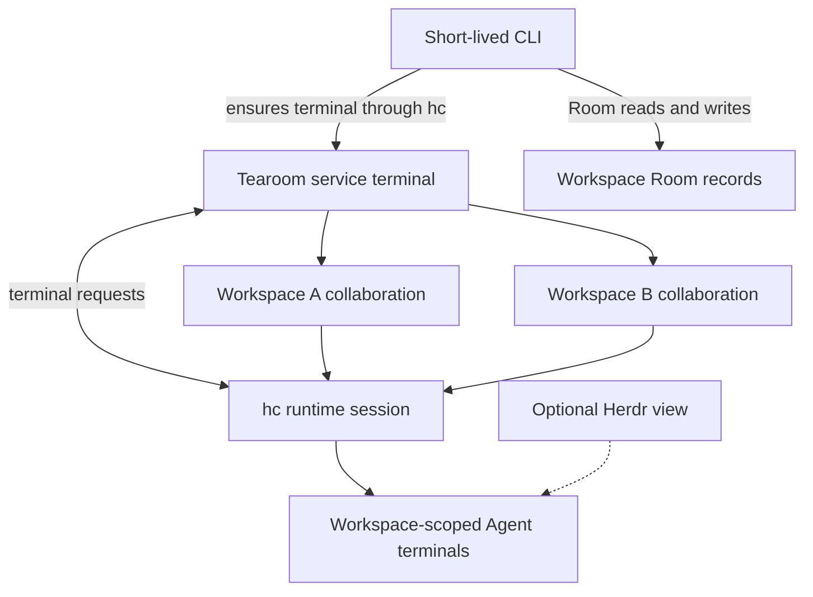

# Room collaboration delivery

This is the local integration for the product and
[user journeys](../domain/user-stories.md). One unattended builder–reviewer
workflow has been exercised; wider acceptance remains open.
The [implementation status](status.md) records what ships. The kernel owns
Room history; this integration owns configuration, delivery and recovery.
The [product boundary](../product.md#conversation-and-runtime-policy) leaves
Agent context management and work decisions to the Agent and its tool.

## Roles and Room panels

Define a reusable role with a stable name, description, agent command,
working-directory setting, and role instructions. Role instructions are an
initial message, not a guaranteed system prompt. Credentials
remain with the agent environment; Room messages and role descriptions do not
store secrets.

Room creation may select role definitions; they can also be changed later. The roster is discoverable
through the CLI and is routing configuration, not permission to read or write.
One Room-role binding identifies one logical panel and at most one active hc
terminal at a time. Different Rooms using the same definition have separate
terminals and conversations. A panel may be created on demand; replacing a
terminal does not itself replace or resume the Agent conversation. A CLI view should
show the role name, description, agent type and observed availability, including
unknown or blocked; it must not claim that an absent or unready panel is ready.
Configuration and commands are documented in the
[Agent integration guide](../reference/agent-integration.md).

### Conversation continuity and replacement

The [product policy](../product.md#conversation-and-runtime-policy) requires
one continuing Agent conversation for each Room-role instance. On its first
wake, start a conversation; later addressed messages go to that conversation,
queued while it is busy. A persistent panel alone is insufficient if the
program inside it starts a fresh conversation on each turn. Role definitions
remain reusable across Rooms, but their conversation histories are separate.
The current implementation starts a new conversation with each new panel;
Tearoom does not bind or resume an Agent session identity.

The product requires recovery of the existing conversation when supported,
and visible reconciliation when its state is uncertain. The current adapter
cannot resume an identified Agent conversation. If a previously used panel is
missing, delivery becomes uncertain instead of silently starting a new one.
An intentional fresh conversation is
an explicit replacement of the Room-role instance, with the prior outcome and
any pending delivery reconciled first. Room records remain the durable shared
history for rebuilding context; conversation and panel identifiers are runtime
integration state, not new product entities or Record fields.

`tearoom collab restart --room <room> --role <role>` is that explicit
replacement: it stops the live panel and starts the configured command again.
It refuses while the panel is working and refuses, without `--confirm`, while
a submitted or uncertain delivery still awaits reconciliation. A replacement
is a new conversation: Tearoom stores no conversation identifier and does not
resume one on the Agent's behalf, because the Agents name continuation
differently and a "most recent" choice can reach another role's conversation.
A restarted Agent can consult Room records; its context remains its own
responsibility. A newly started Agent may report `idle` before its own setup is
finished; the resulting delivery is uncertain and must be inspected rather
than assumed delivered. See
[implementation status](status.md#open-work).

## Message and addressing

All messages remain visible in the Room's single append-only stream. The CLI
stores target role names in structured message content; the Record contract
does not gain recipient fields. The [CLI reference](../reference/cli.md)
defines how explicit targets are selected and
validated. If an unknown role is found in a persisted record, the runtime
reports an undeliverable target without changing the record or routing to
another role.

The wake carries Room records since the role's last confirmed delivery through
the addressed record; the first wake and an explicit restart carry the Room
history through that record. The Agent may read more history if needed. The Room
stream remains the shared history. Builder and reviewer work in the same Room; the
reviewer is a different agent instance. A shared ancestor Room can carry
coordination across branches, with the relevant roles configured there.

## Delivery and recovery

A local integration process observes Room appends and uses hc to start a role
terminal or deliver a prompt to it. hc events report terminal facts, not Room
appends. hc events are hints: on startup and reconnect the integration
scans Room records from its durable boundary, because no event stream
provides replay. The integration stores its delivery progress
outside the Room stream and kernel, keyed by workspace, Room, record sequence,
and target role. It persists delivery intents before moving its scan boundary;
each intent then tracks its own outcome. Re-scanning must not create a second
delivery for that key.
Room-role dispatch is serialized, with later messages pending while that role
is busy. Each service pump pass holds the workspace dispatch lock, as do
manual recovery operations. If the lock is busy, a pump pass skips the scan
and tries again on its next iteration. Other lock errors remain failures.
Manual operations may still report a busy dispatch lock and can be retried.

For each directed message, resolve the configured role and its panel. A first
missing panel is started with its configured command and new Room records;
creating a terminal does not prove that the task was sent. An existing ready
panel receives new records through hc. A busy panel leaves the message pending.
Never force input into a blocked or unready panel. hc readiness and reported
status vary by agent; a tool without reliable status cannot be assumed idle or
done. When readiness cannot be established, the delivery remains pending or is
escalated.

hc 0.1.18 accepts an atomic `--if idle` guard but has no `--if done`. For a
panel reporting `done`, the current adapter rechecks its status and then sends
without `--force`; the check and send are not atomic. A concurrent actor could
start work in that gap. A blocked panel is still refused by hc. This remains
an open reliability limit, not an exactly-once or exclusive-use guarantee.

The runtime distinguishes pending, submission in progress, submitted, and
uncertain delivery. A successful terminal submission is not proof that the
Agent completed the work. A finished turn or matching Room reply can move a
submitted delivery to completed, but a reply is an unverified claim: a
signature and reference do not authenticate its author. Replies cannot
complete pending or uncertain deliveries. The Agent records its result or
blocker in the Room and references the triggering record; inspect that evidence
when deciding whether the claimed work is complete.

On interruption, refresh hc's terminal snapshot and inspect the Room before
deciding what to do. hc event sequence numbers restart and missed events yield
a snapshot, not a complete replay. A spawn or send timeout can mean the action
already happened: reconcile the panel and Room first. If delivery or an
external effect remains ambiguous, expose it for resolution instead of
blindly starting another Agent or repeating the action. Exactly-once execution
is not promised.

## Local collaboration service

Tearoom runs one background collaboration service for the local user and can
register multiple workspaces with it. The service starts on demand: an
addressed CLI send or web append starts it only after the Room record has been
saved, and `collab run` remains a short-lived way to register the current
workspace and ensure the service is running. If an addressed send cannot
activate the service, it reports that the record is already saved. `read` and
`room init` do not start the service. The CLI exits after the request; closing
it or Herdr does not stop ongoing collaboration.

The first activation chooses the hc socket for this per-user service. Further
workspace activations must use that same hc socket; a different session is
rejected with instructions to stop the service before switching. The service
does not change its hc session to match each later CLI command.
The service process also keeps the environment established when its hc
terminal starts. A later CLI's `PATH` or Agent credentials do not automatically
refresh the running service, and no environment-refresh operation is defined.

Use `service status` to inspect the running service and registered workspaces.
`service stop` asks it to stop its Tearoom-managed Agent terminals across the
registered workspaces. It does not stop the shared hc service or unrelated
terminals. If cleanup fails, dispatch stays stopped and `service stop` must be
retried before another activation. After a successful stop, the persistent
registry lets a later activation recover registered workspaces. On service
startup, submitted deliveries are changed to unknown and require inspection;
the service does not replay them automatically.

The service owns Room routing and delivery policy. hc owns terminal execution;
Herdr remains an optional separate view. hc starts Tearoom as a named,
long-lived terminal, independently of the short-lived CLI. Agent terminals use
that service terminal as their hc parent. Workspaces, Rooms, Records, and Roles
retain their existing meanings. Service bookkeeping is not a new product
entity, a Room store, or an authorization boundary. The service is local to the
user and does not expose a remote hosting interface or grant access beyond the
operating-system permissions of that user.

### Lifecycle contract

- Only a successfully appended addressed record activates its workspace
  automatically, whether written through the CLI or web view. Broadcasts,
  reads, workspace initialization, and optional views do not. `collab run` is
  also an explicit activation command.
- The service keeps a per-user registration file and checks each workspace's
  identity before dispatching. Its identity evidence combines filesystem
  device and inode values with the workspace marker's device, inode, and
  content hash. This helps distinguish a replaced workspace at the same path,
  but is not permanent proof of identity and cannot make filesystem checks
  atomic. If the recorded path is missing or identity changes, dispatch pauses
  rather than recreating or silently replacing the registration. The service
  does not scan unrelated directories. Room records and delivery state stay
  in the workspace.
- If a workspace moved, inspect and clean any Agent terminals from its old
  registration, then run `service forget <absolute-old-path> --confirm` and
  activate from the new path. `forget` only removes a stale or missing
  registration; it does not stop terminals. Stop is restricted to an
  identity-derived owner label. Older terminals labeled only by their path are
  reported for manual review and are never killed by the service.
- The service processes registered workspaces serially, sleeping 500
  milliseconds after each pass. One slow workspace can delay delivery and
  control requests for every other registered workspace. Control requests
  wait up to 10 seconds; `service stop` allows up to 300 seconds for cleanup.
  Each workspace's dispatch lock still serializes delivery against manual
  recovery operations.
- Closing a CLI or Herdr view leaves the service and Agent terminals running.
  A normal `service stop` attempts to end terminals carrying the recorded
  identity-derived owner label, records stopped panels, and reports cleanup failures. On
  success, hc ends the service terminal and its children; on cleanup failure,
  dispatch is disabled and the stop must be retried. It preserves Room history
  and does not stop independent hc terminals or another user's work. The
  workspace registry is retained for later activation.
- A service restart changes submitted deliveries to unknown before resuming
  dispatch. The operator must inspect and resolve them; the service does not
  silently replay possibly submitted work or claim that an Agent conversation
  resumed.
- The per-user state directory and Unix socket use user-only permissions. The
  service protocol is local to the user's account; it is not a remote hosting
  interface or a separate workspace authorization boundary.

### Process ownership and recovery limits

The service stops terminals by a recorded identity-derived owner label; it
does not stop the shared hc core. Agent terminals are also children of the
service terminal, so hc can close those children when that parent terminal
ends. The scripted cases and their results are recorded in
[evaluations](../evaluations.md) and remain ignored in the regular test suite
because they start an isolated hc service. Linux,
hc-server failure, real Agent processes, detached descendants, and the race
between identity checks and workspace replacement have not been verified. The
service starts on a later activation; there is no independent login-time
supervisor that restarts it after a crash. An incomplete normal stop leaves
dispatch disabled until cleanup is retried.

## First validation

Create a Room containing a builder and an independent reviewer backed by two
different agent tools. The builder writes progress and explicitly addresses the reviewer;
the reviewer reads that Room, records evidence and a verdict there, and asks
the builder to revise when needed. Verify roster discovery, per-Room panel
isolation, busy and unavailable targets, and no human relay. Include an agent
that does not report hc status and verify pending or escalation. Interrupt the
integration before and after submission and during a turn; show that pending
work is recovered or ambiguity is visible. Record actual runs in
[evaluations.md](../evaluations.md). Authentication and one-time trust prompts
must be resolved before unattended operation.
